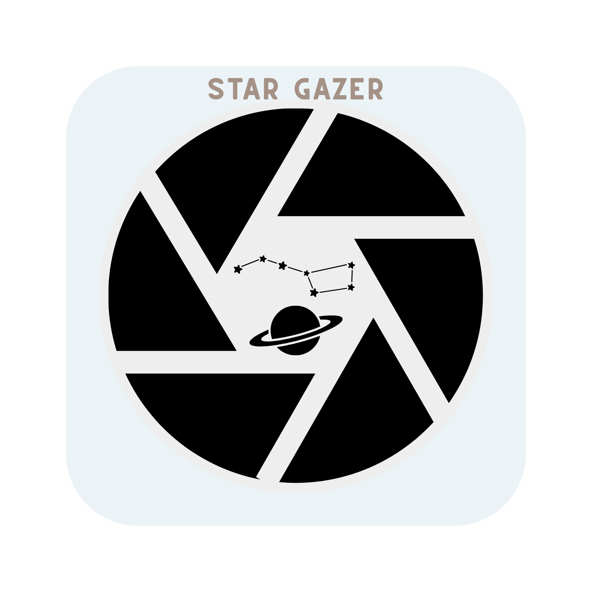

<p align="center">
  <a href="" rel="noopener">
 </a>
</p>

<h3 align="center">STAR GAZER</h3>

<div align="center">

  []() 
  [](https://github.com/Oscar6647/StarGazer)
  [](https://github.com/Oscar6647/StarGazer/issues)
  [](https://github.com/Oscar6647/StarGazer/pulls)
  [](/LICENSE)

</div>

---

<p align="center"> Star Gazer an Astronomical Observational Planner designed to help you make better inform decision and track different astronomical
  events. 
    <br>  Star Gazer can be divided into four key components (Location Zone Target, Sky View Simulation, Space View Simulation, and Instrument Optics Checker) that can help you either plan observational events or improve your astrophotography skills. 
</p>

<!--
Other suggested Contents by the Template 
- [Deployment](#deployment)
- [Usage](#usage)
- [TODO](../TODO.md)
- [Acknowledgments](#acknowledgement)
-->
## 📝 Table of Contents
- [About](#about)
- [Getting Started](#getting_started)
  - [Prerequisites](#Prerequisites)
  - [Installing](#Installing)
- [Built Using](#built_using)
- [Contributing](../CONTRIBUTING.md)
- [Authors](#authors)


## 🧐 About <a name = "about"></a>

Nearly 200+ astronomical events per year occur, so why is it that only a handfull of them are able for us to see them?<br>
A number of factor can be involved that cause it to be a real challenge for us. Among these it can include: Location Factor, visibility factors influence on our
observanility, etc.<br>
And sometimes even when we have the perfect sky to witness them, Optical and Instrument Constrains are what hold us back from witnessing the wonders of space. <br>
With those limitations and constrains in mind, StarGazer was created to help anyone regardless of their technical experience or background. <br>

<h3 align="center">The Cosmos, Just a Gaze Away</h3>


## 🏁 Getting Started <a name = "getting_started"></a>
These instructions will get you a copy of the project up and running on your local machine for development and testing purposes.

### Prerequisites
Read the requirements.txt for any prerequisites needed for the successfull operation of this project.
```
altair==6.2.2
matplotlib==3.10.9
numpy==2.2.6
pandas==2.3.3
requests==2.34.2
streamlit==1.65.0
timezonefinder==8.2.0
tzdata==2026.6
```
Additionally you must create a Skynet Account in order to fully use and plan for any observational event you want to do with a remote telescope. <br>
Visit Skynetgo for more information on how to join: <br>
[Skynetgo website](https://skynetgo.org/) <br>
[Skynetgo documentation](https://docs.skynetgo.org/) 


### Installing
Install any pre-requriements needed

```
pip install requirements.txt
```

Run the following command

```
python -m streamlit run app.py
```
Your enviroment should open a local port and you should see the dashboard.

<!--
## 🔧 Running the tests <a name = "tests"></a>
Explain how to run the automated tests for this system.

### Break down into end to end tests
Explain what these tests test and why

```
Give an example
```

### And coding style tests
Explain what these tests test and why

```
Give an example
```

## 🎈 Usage <a name="usage"></a>
Add notes about how to use the system.

## 🚀 Deployment <a name = "deployment"></a>
Add additional notes about how to deploy this on a live system.
-->

## ⛏️ Built Using <a name = "built_using"></a>
- [](https://www.python.org/)
- [](https://ssd.jpl.nasa.gov/horizons/)
- [](https://your-app-name.streamlit.app)

## ✍️ Authors <a name = "authors"></a>
- <a href="https://github.com/Oscar6647/StarGazer/graphs/contributors">
  
  </a> 
 - [@Oscar6647](https://github.com/Oscar6647) - Creator & Developer

See also the list of [contributors](https://github.com/kylelobo/The-Documentation-Compendium/contributors) who participated in this project.

<!--
## 🎉 Acknowledgements <a name = "acknowledgement"></a>
- Hat tip to anyone whose code was used
- Inspiration:
  - Read Me Template by [@kylelobo](https://github.com/kylelobo)   
- References
-->
